<a href="https://cpguragain.com"></a>

  
  
  
  

 

<a href="https://cpguragain.com/about"></a>

  

<a href="https://cpguragain.com/about"></a>

  

<a href="https://cpguragain.com/projects"></a>

  <a href="https://cpguragain.com/blogs/certprep-coach"></a>
  <a href="https://cpguragain.com/blogs/lodged"></a>

  <a href="https://cpguragain.com/blogs/kitchen-deck"></a>
  <a href="https://cpguragain.com/blogs/building-portfolio-with-ai"></a>

  <a href="https://cpguragain.com/blogs/phoenix-v7"></a>
  <a href="https://cpguragain.com/blogs/cpg-capital"></a>

  <a href="https://cpguragain.com/blogs/home-lab"></a>
  <a href="https://cpguragain.com/projects"></a>

 

<a href="https://cpguragain.com/certifications"></a>

  


  

<a href="https://cpguragain.com/contact"></a>

Panels are generated by <a href="assets/src/build.py"><code>assets/src/build.py</code></a> in the same theme as <a href="https://cpguragain.com">cpguragain.com</a>.

